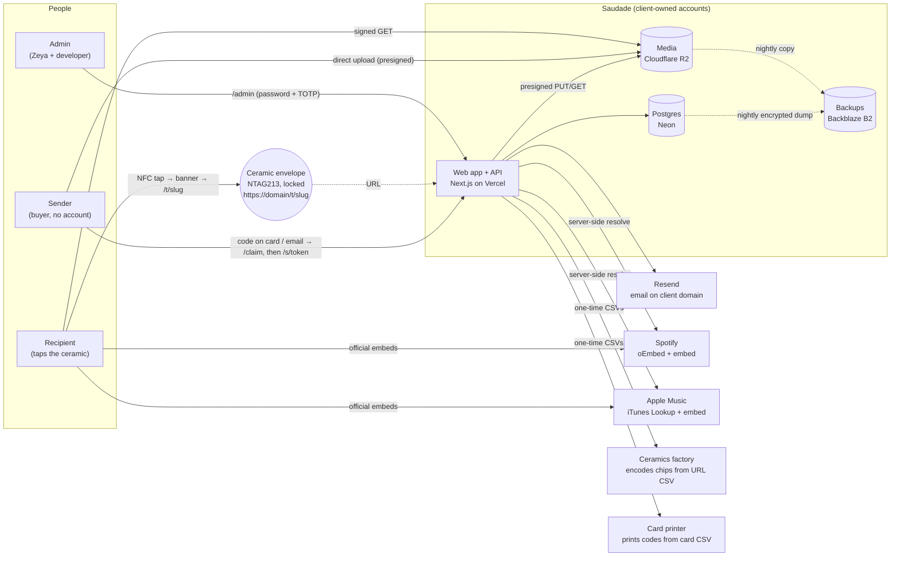
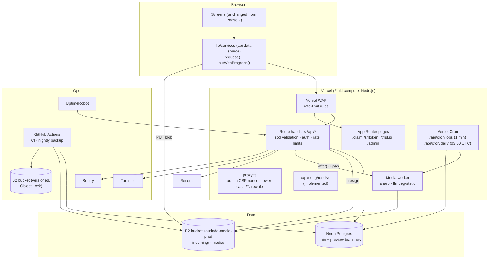
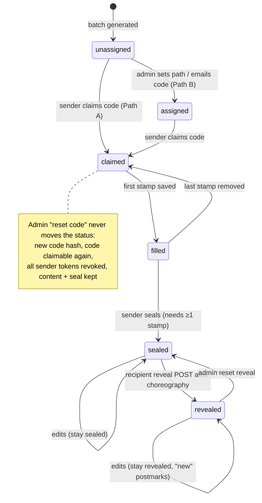
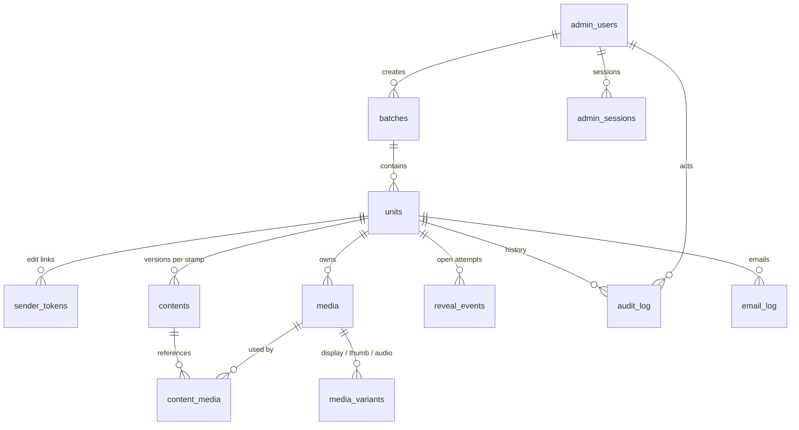
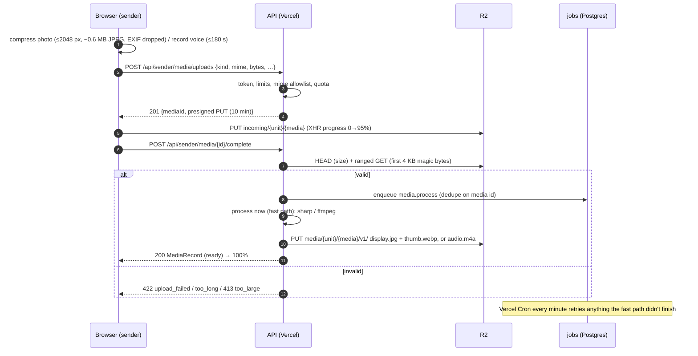
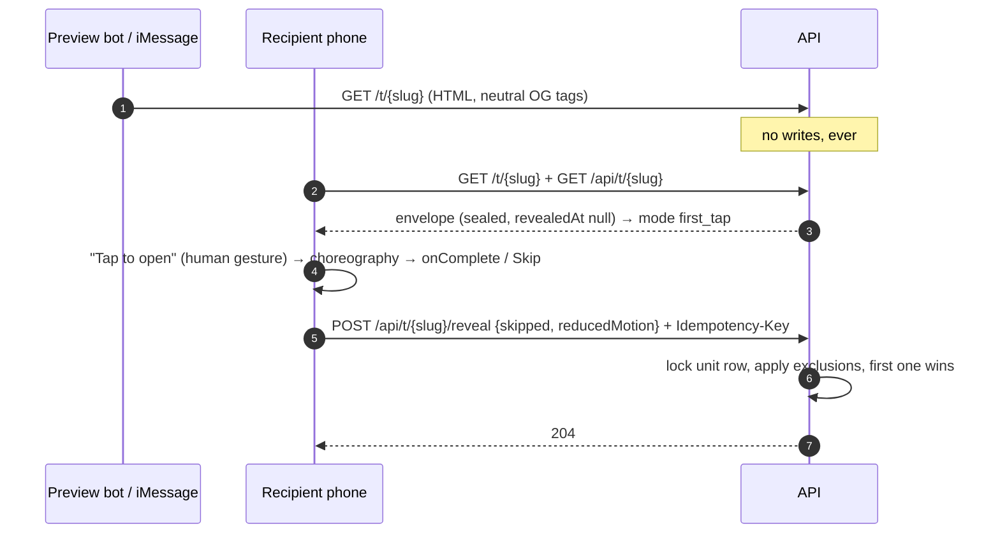
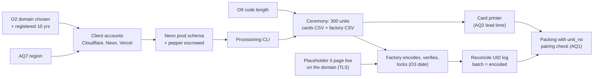

# SAUDADE: ARCHITECTURE (Phase 3 production blueprint)

| Item | Detail |
| --- | --- |
| Owner | System Architect + Backend Engineer |
| Status | v1.0 for PM review. Blueprint only: build starts after showcase approval |
| Date | 8 October 2026 (all prices and platform facts checked on this date) |
| Inputs | `CLIENT_GUIDE.md` (authority #1), `MASTER_BUILD_PROMPT.md` §6.1, §7, §10, `PRD.md`, `RESEARCH.md` §4, `public/demo/song.json` |
| Code that implements parts of this now | `app/api/song/resolve/route.ts` (live), `lib/services/api/*` (HTTP clients for every service), `db/schema.sql` (DDL, validated on PostgreSQL 15) |

**Labels.** [V] verified in a primary source or by a live probe on 8 Oct 2026. [P] secondary source.
[U] unverified, confirm in QA. **[PROPOSED]** team recommendation not yet approved by the client.
**[OPEN Ox]** waits on the client (numbering from `OPEN_QUESTIONS.md`; new questions are `AQ*` in §18 for
the PM to renumber).

---

## 0. Decisions at a glance

> **Update 2026-10-09 (DECISIONS D-075):** the backend is built on **Supabase** (Postgres + Storage) instead of
> Neon + Cloudflare R2. The REST contract (§6), state machine (§4), data model (§5), identifiers (§3), first-open
> rules (§8) and security model (§9) are unchanged; storage is a private Supabase bucket with signed URLs.
> Setup and status: `docs/BACKEND.md`.
>
> **Update 2026-10-16 (DECISIONS D-083 to D-088):** this blueprint is now built: media pipeline (§7), jobs and
> cron (§6.6), song health (§11), TOTP 2FA (§9.4), Turnstile breaker (§9.2), headers and CSP (§9.3), batch
> encoded/void (§6.5), off-provider backups and restore drill (§10, `docs/BACKUPS.md`), handover
> (`docs/HANDOVER.md`). Where the build differs from the text below: storage keys and backups use Supabase
> Storage and its S3 endpoint, not R2; the CSP is two static policies (public, admin), not a nonce policy, and the
> public one allows `'unsafe-eval'` for Spotify's iFrame API (D-085); cron is nightly on every plan, with
> `/api/cron/jobs` optional on Vercel Pro; there is no `proxy.ts` and no upper-case `/T/` rewrite (D-086).
>
> **Update 2026-10-16 (DECISIONS D-089):** two recommendations below were not taken up. **Admin sign-in is email and
> password** (no TOTP 2FA; AQ5 closed): lock-out, per-IP limits, short sessions, CSRF and the audit log remain.
> **Activation codes are 4 characters**, the agreed `SAUD-3K7M` (O9 closed): §3.3 stays as the record of the
> analysis, and the claim limits and breaker (§9.2) are what hold off guessing. Text below that describes TOTP or
> 8-character codes is superseded.
>
> **Update 2026-10-16 (DECISIONS D-090):** the launch checklist is not in the admin; it is the developer's
> `npm run launch:check`. The admin shows only what helps run the business.

| # | Decision | Why |
| --- | --- | --- |
| A1 | **Next.js 16 on Vercel Pro**, Postgres on **Neon (Launch)** via Drizzle, media on **Cloudflare R2**, email via **Resend**, all in **client-owned accounts** | Agreed stack (CG §9). Vercel Hobby is "for personal, non-commercial use" [V], so Pro is required |
| A2 | Chip URL `https://{client-domain}/t/{12-char base32 slug}`, one NDEF URI record, tag **locked** | Fits NTAG213 with 100+ bytes spare; provider domains never touch a chip |
| A3 | ~~Activation code `SAUD-XXXX-XXXX` (8 chars) recommended over `SAUD-XXXX`~~ **Decided: `SAUD-XXXX`, the agreed format** (O9, D-089) | Guessing at scale is held off by the claim limits and breaker (§3.3, §9.2) |
| A4 | Codes stored as **HMAC-SHA-256 with a server pepper**; plaintext exists once, at generation | A DB dump can't be brute-forced; codes can never be re-exported by design |
| A5 | **No object versioning on R2** (it is unimplemented [V]) → versioning is done by the app: immutable keys, versioned DB rows, 90-day soft delete, R2 bucket lock, nightly copy to a versioned **Backblaze B2** bucket | Meets "file versioning" (CG §8) on infrastructure that doesn't offer it natively |
| A6 | Media uploads go **browser → presigned PUT → R2**, never through a function (4.5 MB body limit [V]) | Speed, cost, no size ceiling issues |
| A7 | Image normalisation with **sharp**, audio transcoding with **ffmpeg** inside Vercel Functions, driven by a **Postgres job table + `after()` + Vercel Cron** | Simplest durable option on accounts the client already has; no extra worker host |
| A8 | The first open is recorded **only by a client POST after the choreography**; GET has no side effects; sender-token and admin holders are excluded | Link-preview bots fetch from users' own phones (RESEARCH §4.9) |
| A9 | Rate limits in two layers: **Vercel WAF** (per-IP floods) + **Postgres buckets** (business limits, global breaker) + **Turnstile** when the breaker trips | No extra provider; precise long windows the WAF can't do (max 10 min [V]) |
| A10 | Backups: **Neon PITR (7 days)** + **nightly encrypted `pg_dump`** and **R2 → B2 copy** from a GitHub Action | "Daily backups" that survive the loss of any single provider account |
| A11 | Admin auth: hashed passwords with lock-out, server-side sessions, CSRF header (TOTP 2FA not taken up, D-089) | Admin can reset codes and read every envelope |
| A12 | Recipient route serves **neutral Open Graph** data; content is fetched client-side with `no-store` | Forwarded links and preview cards never leak names, photos or the song |

**Findings that change earlier assumptions (please read):**

1. **R2 has no S3 object versioning.** `PutBucketVersioning` is listed as unimplemented in Cloudflare's S3
   compatibility table [V]. `MASTER_BUILD_PROMPT §7` assumed "R2 … versioning enabled". A5 is the replacement.
2. **`export const runtime` is rejected by Next 16.4 when `cacheComponents` is on** (the dev server errors:
   "Route segment config "runtime" is not compatible with `nextConfig.cacheComponents`") even though the bundled
   segment-config table lists it. Route handlers must not export `runtime` or `dynamic`. `maxDuration` is accepted.
3. **Codes are hashed, so nobody can look them up later.** `emailCode` (Path B) therefore **mints a fresh code** at
   send time and `exportBatchCsv` returns the factory file only. The mock currently re-sends the stored code (§13.3).
4. **Card ↔ ceramic pairing is a physical risk nobody owns yet.** A code card packed with the wrong ceramic sends a
   sender's letter to a stranger's chip. We add a printed `unit_no` to both (§3.7, §17, AQ1).
5. The client was told **"~$10–60/month at 300 units"**. The realistic floor is **~$27/month** because Vercel Pro
   alone is $20 (§12.4).

---

## 1. Scope of this document

Covers everything in `MASTER_BUILD_PROMPT §7`: stack, identifiers, state machine, data model, API, media
pipeline, first-open integrity, security, durability, song handling, cost, migration from the mock layer,
observability, the Phase 3 plan to the **21 November 2026** launch, future-ready items and physical notes.
It does not cover visual design or motion (see `MOTION_SPEC.md`, `DIRECTIONS.md`).

---

## 2. System context, components, environments, accounts

### 2.1 Context



### 2.2 Components



### 2.3 Stack choices

| Layer | Choice | Rejected alternative (why) |
| --- | --- | --- |
| Hosting | Vercel **Pro** ($20/seat/mo, $20 usage credit, 1 TB transfer, 10M edge requests, 1M invocations included [V]) | Hobby (non-commercial only [V]); Render (fine, but Vercel is the Next.js reference platform and already used for previews) |
| Database | **Neon Launch**: no minimum, $0.106/CU-hour, $0.35/GB-month storage, restore window up to 7 days at $0.20/GB-month [V] | Supabase Pro $25/mo + PITR add-on **$100/mo per 7 days** [V] (we only need Postgres); Neon Free (6-hour restore window, scale-to-zero forced [V]) |
| ORM | **Drizzle** + `@neondatabase/serverless` (pooled) | Prisma (heavier runtime, binary engine) |
| Objects | **Cloudflare R2**: $0.015/GB-month, free egress, 10 GB + 1M Class A + 10M Class B free monthly [V] | S3 (egress fees); Vercel Blob (egress fees, ties media to the host) |
| Backups | **Backblaze B2**: $6.95/TB-month, first 10 GB free, versioning + Object Lock [V/P] | Second R2 bucket (same provider, no versioning) |
| Email | **Resend**: free 3,000/mo (100/day), Pro $20/mo for 50,000 [V] | Postmark Basic $15/mo for 10,000 (strong deliverability; free tier only 100/mo [V]); a valid fallback |
| Rate limits | Vercel WAF (fixed window 10 s–10 min, IP/JA4 keys, 40 rules on Pro [V]) + Postgres buckets | Upstash Redis (free 500K commands/mo; $0.20/100K after [V]): an extra account for little gain at this volume |
| Bot challenge | Cloudflare **Turnstile** (free, unlimited, works without Cloudflare proxy [V]) | hCaptcha/reCAPTCHA (privacy, branding) |
| Errors | **Sentry** Developer (free, 5k errors/mo, 1 user [V]) | — |
| Uptime | **UptimeRobot** free (50 monitors, 5-min [V]); Solo $9/mo for 60 s checks [V] | — |

### 2.4 Environments

| Env | URL | Data | Media | Email | Notes |
| --- | --- | --- | --- | --- | --- |
| Local | `localhost:3000` | mock (default) or a Neon dev branch | R2 `saudade-media-staging` | Resend test key, `delivered@resend.dev` only | `NEXT_PUBLIC_DATA_SOURCE=mock\|api` |
| Preview | `*.vercel.app` per PR | Neon branch per preview (Neon ↔ Vercel integration) | `saudade-media-staging` | test key | Own `CODE_PEPPER`; never prod data. Noindex everywhere |
| Production | `https://{client-domain}` | Neon `main` | `saudade-media-prod` | live key, domain verified | The only env that can provision chips |

Region: Vercel functions `iad1` (default) and Neon `aws-us-east-1`, unless the client's customers are mostly in
the EU (AQ7), in which case `fra1` + Neon `aws-eu-central-1` + R2 EU jurisdiction. Decide before the ceremony;
moving a database later is easy, but the R2 jurisdiction is fixed per bucket.

### 2.5 Client-owned accounts and handover

All accounts are created **by the client**, under a shared mailbox she controls (recommended
`tech@{client-domain}`, AQ4), with 2FA on and her payment method. The developer is invited with the least
privilege that works and removed at the end of support. Nothing is billed to us.

| # | Account | Purpose | Plan | Who pays | Developer role | Handover steps |
| --- | --- | --- | --- | --- | --- | --- |
| 1 | **Cloudflare** (Registrar + DNS + R2 + Turnstile) | Chip domain, DNS, media bucket, bot challenge | Registrar at cost (.com $10.46/yr [P]); R2 pay-as-you-go | Client | Member: DNS + R2 admin (no billing) | Register domain **10 years**, auto-renew, registrar lock, 2 payment methods (O2). Create buckets, CORS, lifecycle, bucket lock. API tokens scoped per bucket |
| 2 | **Vercel** (Pro team) | Hosting, WAF, cron | Pro $20/seat/mo | Client | Member while building/supporting | Client owns the team; connect GitHub repo; add domain; set env vars (§9.8) |
| 3 | **Neon** | Postgres | Launch (usage) | Client | Org member | Create project in chosen region; `main` + preview branching; roles from `schema.sql` |
| 4 | **Resend** | Transactional email | Free → Pro | Client | Member | Verify domain (SPF, DKIM, DMARC `p=quarantine` after 2 weeks of clean reports); sending-only API key |
| 5 | **GitHub** (organisation) | Source, CI, nightly backups | Free | Client | Maintainer | Repo transferred to the client org at Phase 3 start (CG §9) |
| 6 | **Backblaze B2** | Off-provider backups | Pay-as-you-go (~$0–1/mo) | Client | None (keys only) | Versioned bucket + Object Lock 35 days; **write-only** application key for GitHub Actions |
| 7 | **Sentry** | Error tracking | Developer (free) | Client | Member | DSN into Vercel env |
| 8 | **UptimeRobot** | Uptime + domain/TLS expiry alerts | Free | Client | — | Alerts to client + developer |
| 9 | **Password manager** (1Password/Bitwarden) | Secret escrow | Client's | Client | Shared vault, read | Holds `CODE_PEPPER`, DB/R2/Resend keys, admin recovery codes, backup decryption key |

---

## 3. Identifiers and URLs

### 3.1 Summary

| Identifier | Who sees it | Format | Entropy | Stored as | Lifetime |
| --- | --- | --- | --- | --- | --- |
| **Activation code** | Sender (card or email) | `SAUD-XXXX-XXXX` [recommended, O9] or `SAUD-XXXX`; alphabet `23456789ABCDEFGHJKMNPQRSTUVWXYZ` (31, no 0/O/1/I/L) | 39.6 bits (8) / 19.8 bits (4) | HMAC-SHA-256 with server pepper | Until claimed; reset mints a new one |
| **NFC slug** | Anyone who taps or receives a forwarded link | 12 chars RFC 4648 base32 lower-case `[a-z2-7]` | 60 bits | Plaintext (it is on the chip) | Forever (chip is locked) |
| **Sender token** | Sender (private link `/s/{token}`) | 32 chars base32 | 160 bits | SHA-256 | Until revoked (admin code reset) |
| **unit_no** | Packers, admin, support | `S-0001` … sequential | none (not a secret) | integer | Forever |
| **Media id** | Holders of the slug/token | `med_` + 26 base32 | 130 bits | Plaintext (capability, 404 once removed) | Until removed |
| **Admin session** | Admin browser cookie | 32 random bytes, base64url | 256 bits | SHA-256 | 12 h idle / 7 d absolute |

All random values come from `crypto.getRandomValues` with rejection sampling (`lib/parsing/codes.ts
randomString`, no modulo bias). Codes and slugs are **independent** random draws: nothing links a card to a
chip except the database row (and the printed `unit_no`).

### 3.2 Activation code

- **Format.** Prefix `SAUD-`, then 8 characters in two groups of four: `SAUD-3K7M-Q9TX`. Same look as the agreed
  example, one more group. If the client keeps 4 (O9), the format is `SAUD-3K7M`.
- **Normalisation (client and server, identical):** upper-case; strip spaces, dashes, underscores, dots; drop a
  leading `SAUD` when the rest is longer than the body length; reject any character outside the alphabet
  (`0 O 1 I L` get the friendly "never used in codes" hint). Implemented in `lib/parsing/codes.ts`; for 8 chars
  `formatCode` needs the grouping change in §19.
- **Storage.** `code_hash = HMAC-SHA-256(CODE_PEPPER_v1, "saudade/code/v1:" + body)` (`units.code_hash`, unique).
  - *Why HMAC and not bcrypt/argon2:* a claim has no username, so the lookup must be by an indexable,
    deterministic value. A per-row salted slow hash would mean running argon2 against every unclaimed row per
    attempt. With only 39.6 bits of input, a plain unsalted SHA-256 could be brute-forced offline from a DB dump
    in about a minute on one GPU; the pepper (in Vercel env and the client's vault, **never in the database or
    backups**) makes a stolen dump useless.
  - *Consequence by design:* there is no way to re-export or look up a code. The card CSV exists exactly once.
  - *Pepper rotation:* add `CODE_PEPPER_v2` for new codes; keep v1 forever to verify old cards
    (`units.code_key_version`). A claim computes the HMAC under each active pepper version (at most two) and
    looks each one up by index.
  - **Losing the pepper kills every unclaimed printed card.** Escrow it in two places (vault + sealed paper).
- **Claim (server):** normalise → rate-limit check → HMAC → `select … for update` by `code_hash` → if
  `code_redeemed_at` is set: `409 already_claimed`; else set `code_redeemed_at`, `claimed_at`, status
  `claimed` (if no content) and issue a sender token. Unknown or malformed: `422 invalid_code`. Both failures
  count towards the limits. Response time does not depend on whether the code exists (one HMAC + one index probe).

### 3.3 Entropy analysis: `SAUD-XXXX` vs `SAUD-XXXX-XXXX` (O9)

**Threat.** An attacker claims *some* unclaimed unit (any one will do) before its buyer does. They get the edit
link of a stranger's envelope and can put anything in front of that recipient at the first tap; the buyer sees
"already claimed". Only **unclaimed** codes are exposed, but codes never expire, so forgotten gifts accumulate.

**Model.** Code space N = 31^k. U unclaimed live codes. Each guess succeeds with p = U/N. An attacker with M IP
addresses, each allowed 50 failed claims a day (the production per-IP limit, §9.2), for D days:
P(at least one hijack) = 1 − (1 − U/N)^(50·M·D). Residential proxy pools make M = 100 cheap and M = 10,000
plausible.

| Code | N | U | One guess in | 1 IP, 1 day | 1 IP, 30 days | 100 IPs, 1 day | 100 IPs, 30 days | 10,000 IPs, 30 days |
| --- | --- | --- | --- | --- | --- | --- | --- | --- |
| `SAUD-XXXX` | 923,521 | 300 | 3,078 | 1.6% | 38.6% | 80.3% | >99% | >99% |
| `SAUD-XXXX` | 923,521 | 3,000 | 308 | 15.0% | 99.2% | >99% (16 hijacks/day) | >99% | >99% |
| `SAUD-XXXXXX` (6) | 887,503,681 | 3,000 | 295,835 | 0.017% | 0.51% | 1.7% | 39.8% | >99% |
| `SAUD-XXXX-XXXX` | 852,891,037,441 | 300 | 2.84 billion | ~0 | 0.00000053% | 0.00018% | 0.0053% | 0.53% |
| `SAUD-XXXX-XXXX` | 852,891,037,441 | 3,000 | 284 million | ~0 | 0.00053% | 0.0018% | 0.053% | 5.1% |

**The global breaker** (§9.2) caps failed claims across *all* IPs at 300/hour (7,200/day) before Turnstile is
required for everyone. Under that cap: 4 chars still loses **2.3 units/day at 300 units** and **23/day at 3,000**;
8 chars gives **0.076% over 30 days** and **0.92% over a full year** of a sustained attack at 3,000 units, while
every one of those attempts must also pass a Turnstile challenge.

**Why rate limits can't rescue 4 characters.** To make 4 chars safe the global failure budget would have to be
a handful a day, and an attacker could then lock every genuine buyer out of `/claim` by spending it. The space
is simply too small for the number of live codes.

**Trade-offs.**

| | `SAUD-XXXX` (agreed example) | `SAUD-XXXX-XXXX` (recommended) |
| --- | --- | --- |
| Security | Not defensible beyond a few dozen units | Infeasible under the limits in §9.2 |
| Card print space | 9 characters, ~30 mm at 14 pt typewriter type | 14 characters, ~48 mm at 14 pt: one line on a business-card insert |
| Typing effort | ~5 s | ~9 s; segmented input (two groups of four), paste-friendly, ambiguous characters refused at the keystroke |
| Email (Path B) | Same | Same (copy/paste) |
| Cost of changing later | Reprint every unclaimed card + email every Path B buyer | None |

**Recommendation (O9):** use **`SAUD-XXXX-XXXX` for every production unit**, starting with the launch batch.
Nothing has been printed yet, so switching now is free; switching after the ceremony means reprinting. Keep
`SAUD-3K7M` style codes for the demo only. (A 6-char middle ground still loses ~40% over a month to 100 IPs.)

### 3.4 NFC slug and chip URL

- **URL:** `https://{client-domain}/t/{slug}`, e.g. `https://saudade.example/t/h4kqzm2xv7pt`. Never a
  `*.vercel.app` or any provider domain (MBP §12): the domain is the only thing we control forever.
- **Slug:** 12 base32 characters (60 bits). With 3,000 units a random slug guess hits 1 in 3.8 × 10^14; slug
  enumeration is also rate-limited (§9.2). Lookups are case-insensitive (`lower(slug)`), so an upper-case QR
  (`HTTPS://DOMAIN/T/SLUG`, alphanumeric QR mode, smaller code) also works via a `proxy.ts` rewrite of `/T/`.
- **NTAG213 byte budget** (RESEARCH §4.3 [V]): user memory 144 bytes; one short NDEF URI record with prefix
  code `0x04` (`https://`) costs **len(domain) + 23 bytes** in total.

| Domain (example) | Length | NDEF bytes | Free of 144 |
| --- | --- | --- | --- |
| `saudade.gift` | 12 | 35 | 109 |
| `saudade.example` (placeholder) | 15 | 38 | 106 |
| `keepsaudade.com` | 15 | 38 | 106 |
| 41-character domain (our ceiling) | 41 | 64 | 80 |

  Keep the domain ≤ 41 characters (RESEARCH target ≤ 64 bytes). If the domain starts with `www.`, use prefix
  `0x02` so `www.` costs nothing. The factory CSV carries an `ndef_bytes` column computed per row so the encoding
  software's numbers can be cross-checked.
- **One record only.** iOS reads only the first URI record [V]; no text record, no AAR.
- **Lock after encoding** (permanent lock bits) once the read-back matches the CSV. Locking does not limit reads.
  A locked tag can never be re-pointed, which is why the domain must be renewed for decades (O2, §10.4).
- **Optional UID/counter mirror** (21 bytes) fits but is **not used**: it would make every tap URL unique and
  defeat caching and the "forwarded link works" behaviour.

### 3.5 Sender token

32 base32 characters (160 bits ≥ 128 required), shown only in the private link `/s/{token}`.
Stored as `sha256(token)` in `sender_tokens`. API calls send it as `Authorization: Bearer …` (never in API
paths or query strings). Several can be active per unit: one from the claim, one per `/recover` (which can't
re-send the old link because only its hash exists), capped at 5 active (oldest revoked as `superseded`).
**Admin "reset code" revokes all of them** (lost or compromised link). Unknown/revoked token → `404 not_found`,
which the portal already renders as "this link doesn't work" (mock parity).

### 3.6 Provisioning ceremony (critical path for the ceramics)

Run once per batch, on a call with Zeya, from the developer's machine against production (CLI
`npm run provision -- --count 300 --label "Launch run" --code-length 8`), or from `/admin/batch`.

1. **Preconditions:** domain final (O2) and resolving with TLS; Neon prod migrated; `CODE_PEPPER_v1` generated
   and escrowed (vault + paper); code length decided (O9); region decided (AQ7).
2. The CLI creates the `batches` row and 300 `units` in **one transaction** (unique slugs, unique code hashes;
   collisions retried) and assigns `unit_no` S-0001…S-0300.
3. It writes **two files, once**:
   - `cards-{batch}.csv`: `unit_no,code` → the card printer (variable-data print). **Secret.**
   - `factory-{batch}.csv`: `unit_no,url,ndef_bytes` → the factory's encoding run. Not secret, but private.
4. Both go straight into the client's vault; the developer's copies are deleted. The card CSV is deleted from
   the vault after cards are printed and QA'd (a damaged card is fixed with "reset code" + reprint one card).
5. The factory encodes, **verifies by read-back**, locks, and returns its log (`unit_no, chip UID, URL`). We
   reconcile 300/300 and mark the batch `encoded` (from then on it can never be voided).
6. If anything is lost **before** encoding, void the batch and regenerate. Nothing is lost.
7. Packing: card S-0042 goes in the box with the ceramic whose base sticker says S-0042 (§17).

Admin `exportBatchCsv` later returns only the factory file (`unit_no,slug,url,ndef_bytes`): codes cannot be
re-exported (A4).

---

## 4. Unit state machine

### 4.1 Diagram (with "Seal & send", O7 approved)



### 4.2 Transitions

| From → To | Trigger (endpoint) | Guard | Effects | Audit |
| --- | --- | --- | --- | --- |
| — → unassigned | Batch generation | count ≤ 5,000 | code hash, slug, unit_no | `batch.generated` |
| unassigned → assigned | `PATCH /api/admin/units/{id}` (path) or `email-code` | admin | `delivery_path`; for B: fresh code minted and emailed, `code_emailed_*` | `unit.path_set`, `unit.code_emailed` |
| unassigned/assigned → claimed | `POST /api/claim` | code matches, `code_redeemed_at` null, rate limits | `code_redeemed_at`, `claimed_at`, path defaults to A, sender token #1 | `unit.claimed` |
| claimed ⇄ filled | `PUT/DELETE /api/sender/contents/{kind}` | valid token | content version +1 / head removed; recomputed from current contents | `content.saved` / `content.removed` |
| filled → sealed | `POST /api/sender/seal` | ≥1 current stamp | `sealed_at` | `unit.sealed` |
| sealed → revealed | `POST /api/t/{slug}/reveal` | not excluded (§8), not yet revealed | `revealed_at`, `reveal_events(outcome=revealed)` | `unit.revealed` |
| revealed → sealed | `POST /api/admin/units/{id}/reset-reveal` | admin | `revealed_at = null`, `reveal_events(outcome=reset)` | `unit.reveal_reset` |
| any (code only) | `POST /api/admin/units/{id}/reset-code` | admin | new code hash, `code_redeemed_at = null`, **all sender tokens revoked**; status, content, seal, reveal untouched | `unit.code_reset`, `unit.tokens_revoked` |
| any (content) | `DELETE /api/admin/units/{id}/contents/{kind}` | admin | head removed (`removed_by=admin`), media soft-deleted; status recomputed (claimed ⇄ filled only) | `content.removed_by_admin` |

Notes:

- `sealed` and `revealed` are sticky: the sender keeps editing (CG §6.2), the recipient sees edits live and
  "new" postmarks (`content_updated_at` vs. the device's last visit).
- A reset code puts a claimed unit back into the claimable pool **without touching what the recipient sees**:
  the rightful sender reclaims with the new code and gets a new link. Typical uses: lost link with no email on
  file, a compromised link, or a hijack (then also remove the content).
- `emailCode` on a unit whose code is already redeemed answers `409 already_claimed` (it would otherwise revoke
  a working sender). The admin resets the code deliberately first.

### 4.3 If the client declines "Seal & send" (O7 → `site.requireSealBeforeReveal = false`)

`sealed` disappears: `filled → revealed` on the first reveal, and `resolveRecipientMode` already treats
`filled` as `first_tap`. The seal endpoint is hidden. **Risk to explain to the client:** with Path B the
ceramic can arrive while the sender has saved one photo of fifteen; the first tap then spends the ceremony on
a half-written letter. Recommended default stays "seal on".

### 4.4 Recipient mode

Unchanged from the prototype (`lib/recipient-mode.ts`): `not_found` (unknown slug) · `empty` (nothing inside, or
not sealed while sealing is required) · `first_tap` (sealed, never revealed) · `repeat` (revealed). The server
never decides the mode on GET and never writes on GET.

---

## 5. Data model

Full DDL with constraints, indexes and comments: **`db/schema.sql`** (applied and smoke-tested on PostgreSQL 15:
constraint violations, the one-head-per-stamp index, append-only audit trigger and rate-limit upsert all behave
as specified).



| Table | Purpose | Key points |
| --- | --- | --- |
| `batches` | One provisioning ceremony | `status generated → encoded` (or `void` before encoding), `code_length`, `chip_domain` |
| `units` | One ceramic | `unit_no` identity, `slug` unique `[a-z2-7]{12}`, `code_hash` unique 32 bytes, `code_redeemed_at`, lifecycle `status` with consistency checks |
| `sender_tokens` | Edit links | SHA-256 hash, origin (`claim`/`recover`/`admin`), `revoked_at` + reason |
| `contents` | The four stamps | Append-only versions; `payload jsonb` = the `StampContent` JSON, `kind` must match; partial unique index = one head per (unit, kind); remove = `removed_at` on the head |
| `current_contents` (view) | What screens show | Head rows that aren't removed |
| `media` | Uploaded photo/voice | Capability id, declared vs detected mime, original R2 key (transient), dimensions/duration checks, soft delete with `purge_after` |
| `media_variants` | Normalised files | Immutable `r2_key` per (media, variant, version) |
| `content_media` | Which media a content version uses | Drives garbage collection safely |
| `reveal_events` | Every reveal POST | Outcome enum (`revealed`, `duplicate`, `sender_excluded`, `admin_excluded`, `bot_ignored`, `not_revealable`, `reset`), idempotency key unique per unit, hashed IP |
| `audit_log` | Who did what | Append-only (UPDATE/DELETE/TRUNCATE raise), no secrets in `detail` |
| `email_log` | Admin outbox | **No bodies stored** (they contain links and codes) |
| `song_catalog` | Song health | One row per distinct track; daily availability check |
| `jobs` | Durable queue | `for update skip locked`, attempts, backoff, dead-letter state |
| `rate_limit_buckets` | Business limits | Fixed-window counters via upsert; logged table (Neon computes restart) |
| `idempotency_keys` | Retried POSTs | Response body **not** stored for secret-bearing scopes |
| `admin_users` / `admin_sessions` | Admin auth | argon2id; TOTP secret encrypted [PROPOSED]; hashed session ids |

### 5.1 Versioning

- **Content:** every save inserts `version = n + 1` and stamps `superseded_at` on version n in one transaction;
  the API returns `ContentRecord.version`. Removing a stamp marks the head `removed_at`; history stays. Admin can
  restore any earlier version (support tool, Phase 3.1).
- **Media:** never overwritten. A re-record or replacement is a new `media` row; a reprocess is a new
  `media_variants.version` under a new key. Removed media remains recoverable for **90 days** (`purge_after`).
- **Objects:** immutable keys + R2 bucket lock + nightly copy into a **versioned** B2 bucket (§10).

### 5.2 Retention

| Data | Kept | Then |
| --- | --- | --- |
| Current content and media | For the life of the product ("codes never expire") | — |
| Superseded content versions | Forever (small JSON) | Admin can purge on request |
| Removed media (R2 objects) | 90 days | Purge job deletes objects; row kept with `purged_at` |
| Raw uploads (`incoming/`, may carry EXIF/GPS) | 7 days after processing | R2 lifecycle rule deletes |
| `reveal_events` | Forever | `ip_hash` nulled after 90 days |
| `audit_log` | Forever | — |
| `email_log` | 13 months | `to_email` pseudonymised |
| `admin_sessions` | 30 days | Deleted |
| `rate_limit_buckets`, `idempotency_keys` | 2 days | Deleted hourly/daily |
| Nightly DB dumps (B2) | 35 daily + 12 monthly | Object Lock 35 days, lifecycle |
| Neon history | 7 days (Launch max) | — |

A sender asking for deletion: admin removes all stamps and clears `sender_email`. Removed content is unreachable
immediately (no signed URLs are issued; `/api/media/{id}` returns 404); the objects are physically deleted after
90 days, or earlier by a logged admin purge once the 30-day R2 bucket lock allows. Legal wording comes from the
client.

---

## 6. REST API

### 6.0 Conventions

- Same origin, JSON, `Cache-Control: no-store` on every API response (except the media redirect).
- **Errors:** `{ "code": ServiceErrorCode, "detail"?: string, "retryAfterSec"?: number }` with a matching
  status: `400` malformed, `401/403 unauthorized`, `404 not_found`, `409 already_claimed | nothing_to_seal`,
  `413 too_large`, `422 invalid_code | too_long | unsupported_link | upload_failed`, `429 rate_limited` +
  `Retry-After`, `502/503 network`. The client helper (`lib/services/api/http.ts request()`) prefers the body
  `code`, falls back to the status, and never throws.
- **Auth:** sender = `Authorization: Bearer {token}`; admin = `__Host-saudade_admin` cookie + `X-Saudade-CSRF: 1`
  on non-GET + `Origin` check; recipient = slug only.
- **Validation:** zod schemas mirror `lib/services/types.ts`; JSON bodies ≤ 64 KB; strings trimmed and capped
  (`site.limits`). Media bytes never pass through a function.
- **Idempotency:** `Idempotency-Key` header on reveal, batch generation and code emails.
- Unknown or revoked sender token → `404 not_found` (portal shows "link doesn't work"; same as the mock).

### 6.1 Units and claim

| Method & path | Auth | Request | Response | Errors | Rate limit |
| --- | --- | --- | --- | --- | --- |
| `POST /api/claim` | none (+ `turnstileToken` when breaker is on) | `{ code }` | `200 ClaimResult { token, slug, senderUrl }` | 422 `invalid_code`, 409 `already_claimed`, 429 | WAF 20/min/IP; app: 10 failures/15 min/IP, 30/24 h/IP; global breaker 300 failures/h |
| `PUT /api/sender/email` | Bearer | `{ email }` | `204`; emails the link built from the presented token (`sender_link`) | 404, 400 | 5/h/unit |
| `POST /api/recover` | none | `{ email }` | `202` always (no enumeration). Server mints one new token per matching unit and emails the links (`recover_link`) | 429 | WAF 10/10 min/IP; app 3/h per email hash, 10/day/IP |
| `POST /api/sender/seal` | Bearer | — | `200 SenderEnvelope` (idempotent if already sealed) | 404, 409 `nothing_to_seal` | 30/h/unit |

### 6.2 Sender content

| Method & path | Auth | Request | Response | Errors | Rate limit |
| --- | --- | --- | --- | --- | --- |
| `GET /api/sender/envelope` | Bearer | — | `200 SenderEnvelope` + wire-only `mediaUrls { id: { url, expiresAt } }` | 404 | WAF 300/min/IP |
| `PUT /api/sender/contents/{kind}` | Bearer | `StampContent` of that kind | `200 ContentRecord` (version +1; status recomputed) | 404; 422 when: >15 photos, media not `ready` or not this unit's, letter > 2,000 chars, voice > 180.5 s, song fails re-validation | 120/h/unit |
| `DELETE /api/sender/contents/{kind}` | Bearer | — | `200 SenderEnvelope` | 404 | 120/h/unit |
| `POST /api/song/resolve` | none (same-origin) | `{ link }` | `200 SongContent` | 400/413/422 `unsupported_link`, 404 `not_found`, 429, 502 `network` | 30/min/IP (implemented in-memory now; WAF in prod) |

On song save the server **never trusts client-supplied `embedUrl`/`url`**: it re-derives them from
`provider + trackId (+ albumId, storefront)` with the helpers in `lib/parsing/songs.ts`, sanitises title/artist,
and upserts `song_catalog`.

### 6.3 Media

| Method & path | Auth | Request | Response | Errors | Rate limit |
| --- | --- | --- | --- | --- | --- |
| `POST /api/sender/media/uploads` | Bearer | `MediaMeta + { bytes, mime }` | `201 { mediaId, upload: { url, method: "PUT", headers, expiresAt } }` (presigned, 10 min, `Content-Type` + `Content-Length` signed) | 404, 413 `too_large`, 422 `too_long` / bad mime | 60/h/unit; ≤ 40 pending per unit |
| `PUT {presigned R2 URL}` | signature | blob | `200` from R2 | 403 if expired/mismatched → client shows `upload_failed` | — |
| `POST /api/sender/media/{id}/complete` | Bearer | — | `200 MediaRecord` once normalised (sync fast path; idempotent) | 404, 413, 422 `upload_failed` (magic bytes/undecodable), 422 `too_long`, 503 `network` (retry: job continues) | 60/h/unit |
| `DELETE /api/sender/media/{id}` | Bearer | — | `204` (soft delete; deferred while a current stamp still references it) | 404 | 120/h/unit |
| `GET /api/media/{id}?v=display\|thumb\|audio` | capability id | — | `302` → signed R2 URL; `Cache-Control: private, max-age=600` | 404 (unknown, removed, not ready) | WAF 600/min/IP |

### 6.4 Recipient

| Method & path | Auth | Request | Response | Errors | Rate limit |
| --- | --- | --- | --- | --- | --- |
| `GET /api/t/{slug}` | none | — | `200 RecipientEnvelope` + `mediaUrls`. **No side effects.** | 404 | WAF 120/min/IP; app: 30 not-found/10 min/IP → 429 (enumeration tripwire) |
| `POST /api/t/{slug}/reveal` | none, or Bearer (sender exclusion), or admin cookie (exclusion) | `{ skipped, reducedMotion }` + `Idempotency-Key` | `204` always (outcome recorded server-side) | 404 | WAF 20/min/IP |

### 6.5 Admin (cookie + CSRF)

| Method & path | Request | Response | Errors |
| --- | --- | --- | --- |
| `POST /api/admin/session` | `{ email, password, otp? }` | `200 AdminSession` + `Set-Cookie` | 401 `unauthorized` (`detail`: `invalid_credentials` \| `otp_required` \| `locked`), 429 |
| `GET /api/admin/session` | — | `200 AdminSession` | 401 |
| `DELETE /api/admin/session` | — | `204` | — |
| `GET /api/admin/stats` | — | `200 AdminStats` | 401 |
| `GET /api/admin/units?search&status&batchId&page&pageSize` | — | `200 UnitListPage` (`code` masked `SAUD-····`, `senderToken` null) | 401 |
| `GET /api/admin/units/{id}` | — | `200 UnitDetail` | 401, 404 |
| `POST /api/admin/units/{id}/reset-code` | — | `200 { code }` (plaintext, once) | 401, 404 |
| `POST /api/admin/units/{id}/reset-reveal` | — | `204` | 401, 404 |
| `POST /api/admin/units/{id}/email-code` | `{ to }` + `Idempotency-Key` | `200 EmailMessage` (fresh code minted) | 401, 404, 409 `already_claimed` |
| `PATCH /api/admin/units/{id}` | `{ path: "A" \| "B" }` | `204` | 401, 404 |
| `DELETE /api/admin/units/{id}/contents/{kind}?photoId=` | — | `204` | 401, 404 |
| `GET /api/admin/batches` | — | `200 Batch[]` | 401 |
| `POST /api/admin/batches` | `{ count, label }` + `Idempotency-Key` | `201 { batch, rows: [{ code, slug, url }] }` (only time codes exist; a replayed key gets 409, never the codes again) | 401, 409 |
| `GET /api/admin/batches/{id}/export.csv` | — | `text/csv`: `unit_no,slug,url,ndef_bytes` | 401, 404 |
| `POST /api/admin/batches/{id}/encoded`, `/void` [new] | — | `204` | 401, 409 (void after encoded) |
| `POST /api/admin/emails` | `{ template, to, link?, code? }` | `200 EmailMessage` (server renders from the template; client text ignored) | 401 |
| `GET /api/admin/emails?limit=50` | — | `200 EmailMessage[]` (link/code redacted) | 401 |

Search: input that normalises to a full code → HMAC exact match; otherwise slug prefix, `unit_no`, or email
`ilike`. Admin rate limits: WAF 10/10 min/IP on the session endpoint; 5 failed sign-ins → 15-min account lock;
20 failures/day/IP.

### 6.6 Ops

| Method & path | Auth | Purpose |
| --- | --- | --- |
| `GET /api/health` | none | `{ ok, db, version }` for uptime checks (no secrets, no counts) |
| `GET /api/cron/jobs` | `Authorization: Bearer CRON_SECRET` (Vercel Cron) | Every minute: run due jobs (media retries, emails) |
| `GET /api/cron/daily` | same | 03:00 UTC: song checks, purges, ip-hash expiry, bucket/session cleanup |
| `POST /api/webhooks/resend` | Svix signature | Delivery/bounce status into `email_log` |

### 6.7 Service method → endpoint map (what `lib/services/api/*` calls)

| Service method | Endpoint |
| --- | --- |
| `units.claim` | `POST /api/claim` |
| `units.saveSenderEmail` | `PUT /api/sender/email` |
| `units.recoverLink` | `POST /api/recover` |
| `units.seal` | `POST /api/sender/seal` |
| `content.getSenderEnvelope` | `GET /api/sender/envelope` |
| `content.resolveSong` | `POST /api/song/resolve` |
| `content.save` | `PUT /api/sender/contents/{kind}` |
| `content.remove` | `DELETE /api/sender/contents/{kind}` |
| `media.upload` | `POST …/uploads` → `PUT` R2 (XHR progress) → `POST …/{id}/complete` |
| `media.getUrl` | cache from `mediaUrls`, else `/api/media/{id}` (302) |
| `media.remove` | `DELETE /api/sender/media/{id}` |
| `reveal.getEnvelope` | `GET /api/t/{slug}` |
| `reveal.markRevealed` | `POST /api/t/{slug}/reveal` |
| `admin.*` | §6.5 |
| `email.send` / `email.outbox` | `POST` / `GET /api/admin/emails` |

---

## 7. Media pipeline



1. **Client** (already real in Phase 2): `browser-image-compression` to `site.limits.photoMaxEdge` 2048 px and
   ~0.6 MB; canvas re-encoding drops EXIF including GPS. Voice: MediaRecorder with the AAC-first candidate list;
   the real `recorder.mimeType` is sent as `mime`. Uploads ≤ `photoInputMaxMB` / `voiceUploadMaxMB`.
2. **Presign:** `PutObject` URL for `incoming/{unit_id}/{media_id}`, 10-minute expiry, `Content-Type` and
   `Content-Length` bound into the signature. R2 bucket CORS allows `PUT, GET, HEAD` from the production origin
   (and preview origins on the staging bucket) with `Content-Type`.
3. **Validation on complete (never trust the client):** object exists and size ≤ declared limit; magic bytes:

   | Accepted | Signature |
   | --- | --- |
   | JPEG | `FF D8 FF` |
   | PNG | `89 50 4E 47 0D 0A 1A 0A` |
   | WebP | `RIFF....WEBP` |
   | HEIC/HEIF | `....ftyp` + `heic`/`heix`/`mif1`/`msf1` |
   | MP4/M4A/AAC | `....ftyp` + `M4A `/`mp42`/`isom`/`iso5` |
   | WebM | `1A 45 DF A3` |
   | Ogg | `OggS` |
   | MP3 | `ID3` or `FF Fx` |
   | WAV | `RIFF....WAVE` |

   Everything else (GIF, SVG, PDF, HTML, video) → `422 upload_failed`.
4. **Images (sharp/libvips in the function):** `limitInputPixels` 50 MP (decompression-bomb guard); `.rotate()`
   applies EXIF orientation; output **display** = long edge 1600 px JPEG q80 mozjpeg (~250–450 KB), **thumb** =
   480 px WebP q70 (~30–50 KB). sharp writes **no metadata unless asked**, so EXIF/GPS/XMP/ICC-extras are gone;
   colour converted to sRGB. **HEIC:** sharp's prebuilt binaries don't decode HEVC-HEIC [U: confirm], so the
   rare HEIC upload (iOS normally hands Safari a JPEG [U]) is decoded with `heic-decode` (libheif WASM) first.
5. **Audio (ffmpeg-static in the function, ~80 MB, inside the 250 MB bundle limit [V]):**
   `ffprobe` duration ≤ 180.5 s (else `too_long`), then
   `ffmpeg -i in -vn -ac 1 -ar 44100 -af loudnorm=I=-16:TP=-1.5:LRA=11 -c:a aac -b:a 64k -movflags +faststart audio.m4a`.
   Every voice note is served as **AAC/m4a**, which plays on every target including iOS before 18.4.
6. **Where it runs, and why:** in the `/complete` request itself (fast path: photos < 1 s, a 3-min voice note
   ~2–4 s of CPU), with the job row as the durable record and **Vercel Cron every minute** as the retry sweeper
   (5 attempts, exponential backoff, then `dead` with an admin flag). No extra host. Cloudflare Workers can't run
   sharp/ffmpeg; Mux/Stream are video products and overkill; a separate container is another account to keep
   alive for years.
7. **Storage layout:** `incoming/{unit}/{media}` (deleted by lifecycle 7 days after processing) and
   `media/{unit}/{media}/v{n}/{display.jpg|thumb.webp|audio.m4a}` (immutable; objects written with
   `Cache-Control: private, max-age=31536000, immutable`). **R2 bucket lock:** 30-day retention on `media/`,
   so a leaked key or a bug cannot delete anything recent; the purge job runs only after 90 days anyway.
8. **Delivery:** `/api/media/{id}?v=…` returns `302` to an R2 presigned GET valid for 1 hour. The signing time is
   **bucketed to the hour**, so the URL is identical for every view in that hour and the browser cache works.
   Envelope responses pre-sign every URL they reference (`mediaUrls`), so the recipient page loads images
   with zero extra round trips. Range requests work (audio scrubbing). Responsive images: `srcset` of
   `thumb` (480w) and `display` (1600w) once `getUrl` gains a variant (§19). Post-launch option: a ~40-line
   Cloudflare Worker on `media.{domain}` with HMAC tokens and edge caching, only if real traffic warrants it.

---

## 8. First-open integrity



Rules (contract for the recipient route and the API):

1. **GET has no side effects**, for pages and APIs alike. Preview fetchers (Apple, Google Messages, WhatsApp,
   Slack, Telegram, Discord, X, Meta) can fetch as often as they like.
2. **Reveal = client POST after "Tap to open" and after the choreography's `onComplete` (or Skip).** Bots don't
   tap, so they can't reach it. Never on mount, never from `/s/{token}/preview` (separate route, forced mode).
3. **Exclusions (outcome recorded, nothing consumed):** a valid sender token for this unit (`sender_excluded`:
   the API client attaches the token it remembers for the slug, so a sender testing their own ceramic doesn't
   use up the moment); an admin session cookie (`admin_excluded`: packing checks); a user agent on the backstop
   list (`bot_ignored`).
4. **Backstop UA list** (logs and outcome only, never the guard): `facebookexternalhit`, `Facebot`, `Twitterbot`,
   `Slackbot-LinkExpanding`, `Slackbot`, `TelegramBot`, `Discordbot`, `WhatsApp/`, `GoogleMessages`,
   `LinkedInBot`, `SkypeUriPreview`, `Pinterestbot`, `redditbot`, `Applebot`, `Googlebot`, `bingbot`,
   `Embedly`, `Iframely`, the frozen Apple preview UA (`Version/9.0.1 Safari/601.2.4 facebookexternalhit/1.1`).
5. **Idempotent and race-safe:** the reveal transaction locks the unit row; only a sealed (or, with O7 off,
   filled) unit with `revealed_at` null becomes `revealed`. Repeats → `duplicate`; `(unit_id, idempotency_key)`
   is unique. Two phones tapping at once: one `revealed`, one `duplicate`, both see the full ceremony locally.
6. **Offline:** if the POST fails, the client marks the reveal in `localStorage` and retries later, so the same
   phone doesn't replay the ceremony; other devices still follow the server.
7. **Neutral metadata on `/t/*`:** title "A letter is waiting for you", a generic sealed-envelope image, no
   names, photos or song; `noindex` + `X-Robots-Tag` (already global in `next.config.ts`). Content is loaded by
   the client from `/api/t/{slug}` with `no-store`, never server-rendered into the HTML a crawler sees.

---

## 9. Security

### 9.1 Threats and controls

| Threat | Control |
| --- | --- |
| Guessing activation codes | 8-char codes (§3.3), rate limits + global breaker + Turnstile (§9.2), uniform responses |
| Guessing slugs / tokens | 60 / 160 bits; not-found tripwire on `/t/*` |
| Link-preview bots spending the first open | §8 |
| Stolen DB dump | Codes HMAC-peppered, tokens/sessions hashed, TOTP secrets encrypted, no message bodies stored |
| Malicious uploads | Magic bytes, size/duration/pixel limits, re-encode everything (no original served), separate storage host |
| XSS | React escaping, letter rendered as text (no HTML), CSP (§9.3), no third-party scripts except Spotify iFrame API and Turnstile |
| CSRF on admin | SameSite=Strict cookie + custom header + Origin check |
| SSRF via song links | Host allowlist on every hop, https only, manual redirects, timeouts, capped reads (implemented) |
| Admin takeover | argon2id, TOTP [PROPOSED], lockout, short sessions, audit log, alerts on sign-in from new IP |
| Open relay | No public send endpoint; templates only; admin-only `send` |
| Provider lock-in / domain loss | Client-owned domain on chips, 10-year registration, standard formats (§10.4) |

### 9.2 Rate limits

| Route | Edge (Vercel WAF, per IP, fixed window) | App (Postgres buckets) | On trip |
| --- | --- | --- | --- |
| `POST /api/claim` | 20 / 60 s | Failures: 10 / 15 min / IP, 30 / 24 h / IP. **Global breaker:** > 300 failures / hour across all IPs | 429 + `Retry-After`; breaker → Turnstile required for every claim for 6 h + email alert |
| `POST /api/recover` | 10 / 10 min | 3 / h per email hash; 10 / day / IP | 429 (same copy as success would leak nothing) |
| `GET /t/*`, `GET /api/t/*` | 120 / 60 s | 30 not-found / 10 min / IP | 429 |
| `POST /api/t/*/reveal` | 20 / 60 s | — (idempotent) | 429 |
| `POST /api/admin/session` | 10 / 10 min | 5 failures → account locked 15 min; 20 failures / day / IP | 401 `locked` / 429 |
| `POST /api/song/resolve` | 30 / 60 s | — | 429 |
| Sender API `/api/sender/*` | 300 / 60 s | Uploads 60 / h / unit; saves 120 / h / unit | 429 |
| `GET /api/media/*` | 600 / 60 s | — | 429 |

IPs are keyed as `HMAC(IP_HASH_KEY, ip)`; raw IPs are never stored. WAF counters are per region [V], which is
why the precise limits live in Postgres.

### 9.3 Headers and CSP

Already global (`next.config.ts`): `X-Robots-Tag: noindex, nofollow, noarchive`, `Referrer-Policy`,
`X-Content-Type-Options`, `Permissions-Policy` (mic self only). Add in Phase 3:

- `Strict-Transport-Security: max-age=63072000; includeSubDomains` (add `preload` once the domain is final).
- `Referrer-Policy: no-referrer` on `/s/*` (the token is in the path).
- `Cross-Origin-Opener-Policy: same-origin`; `X-Frame-Options: DENY`.
- **CSP (public + sender + recipient routes, no nonces):** nonces force dynamic rendering of every page [V: Next CSP
  guide], which would throw away the static shell that keeps the recipient LCP under 2.5 s. So:

```
default-src 'self';
script-src 'self' 'unsafe-inline' https://open.spotify.com https://challenges.cloudflare.com;
style-src 'self' 'unsafe-inline';
img-src 'self' data: blob: https://i.scdn.co https://*.spotifycdn.com https://*.mzstatic.com https://{R2_ACCOUNT_ID}.r2.cloudflarestorage.com;
media-src 'self' blob: https://{R2_ACCOUNT_ID}.r2.cloudflarestorage.com;
connect-src 'self' https://open.spotify.com https://itunes.apple.com https://{R2_ACCOUNT_ID}.r2.cloudflarestorage.com https://*.ingest.sentry.io;
frame-src https://open.spotify.com https://embed.music.apple.com https://challenges.cloudflare.com;
font-src 'self'; worker-src 'self' blob:; object-src 'none'; base-uri 'self'; form-action 'self';
frame-ancestors 'none'; upgrade-insecure-requests
```

- **`/admin/*`:** strict nonce CSP (`script-src 'self' 'nonce-…' 'strict-dynamic'`) from `proxy.ts`; the admin is
  fully dynamic anyway and is the highest-value target. Evaluate Next's experimental SRI after launch.

### 9.4 Admin authentication

- Accounts created by CLI only. Passwords ≥ 14 characters, checked against a breached-password list (k-anonymity
  range query), hashed with argon2id (`@node-rs/argon2`, m = 19 MiB, t = 2, p = 1).
- No second factor (AQ5 not taken up, D-089): email and password only.
- Session: 256-bit random id in `__Host-saudade_admin` (`Secure; HttpOnly; SameSite=Strict; Path=/`), hashed in
  `admin_sessions`, 12 h idle / 7 d absolute, revocable; re-auth for "generate batch" and "reset code".
- Lockout and alerting per §9.2; every sign-in, failure and admin action lands in `audit_log`.

### 9.5 Sender authentication

No accounts (CG §4). The token in `/s/{token}` is the key; the UI explains it once ("anyone with this link can
edit"). The API never puts it in a path or query string. Vercel's request logs still record page paths: only
people with dashboard access (who are admins anyway) can see them, and logs expire on the platform's schedule.

### 9.6 No PII in URLs, logging

URLs carry only random identifiers. Logs are structured JSON with a request id; never log request bodies,
emails, codes, tokens, signed URLs or IPs (IP → HMAC). Sentry scrubs `authorization`, `cookie`, `code`, `email`.

### 9.7 Secrets

| Secret | Where | Rotation | Escrow |
| --- | --- | --- | --- |
| `CODE_PEPPER_V1` (32 random bytes) | Vercel env, **production only** | Never casually; add V2 for new codes, keep V1 | Vault **and** sealed paper copy (loss = every unclaimed card dead) |
| `DATABASE_URL` (pooled, login role ∈ `saudade_app`) | Vercel env per environment | Yearly / on staff change | Vault |
| `IP_HASH_KEY` | Vercel env | Any time (only breaks correlation) | Not needed |
| `CRON_SECRET` | Vercel env | Yearly | Vault |
| `R2_ACCESS_KEY_ID/SECRET` (bucket-scoped read/write) | Vercel env | Yearly | Vault |
| `RESEND_API_KEY` (sending-only) | Vercel env | Yearly | Vault |
| `TURNSTILE_SECRET_KEY` | Vercel env | — | Vault |
| Backup: read-only DB URL, B2 write-only key, `age` **public** key | GitHub Actions secrets | Yearly | Vault |
| Backup decryption: `age` **private** key | **Offline only** (vault + paper) | Never stored on a server | Vault + paper |

### 9.8 Audit log

Append-only at the database level (trigger rejects UPDATE/DELETE/TRUNCATE; the app role also lacks the grants).
Actions: everything in `AuditAction` plus `unit.token_issued`, `unit.tokens_revoked`, `unit.reveal_excluded`,
`media.rejected`, `batch.encoded`, `batch.voided`, `admin.signed_out`, `admin.sign_in_failed` (§19). Shown on the
unit detail screen and the dashboard.

---

## 10. Durability and disaster recovery

### 10.1 Backups

| What | How | Frequency | Retention | Where |
| --- | --- | --- | --- | --- |
| Postgres (point in time) | Neon history / instant restore | Continuous | 7 days (Launch maximum [V]) | Neon |
| Postgres (logical) | GitHub Action: `pg_dump -Fc` as `saudade_readonly` → `age` encrypt → upload | **Daily** 02:30 UTC | 35 daily + 12 monthly; B2 Object Lock 35 days | B2 `saudade-backups/db/` |
| Media | Immutable keys + 90-day soft delete + R2 bucket lock (30 days on `media/`) | Continuous | — | R2 |
| Media (off-provider) | GitHub Action: `rclone copy` (never `sync`) R2 `media/` → B2 versioned bucket | Daily 03:00 UTC | Versions kept 90 days | B2 `saudade-backups/media/` |
| Code + config | GitHub (client org); Vercel keeps every deployment | Every push | Forever | GitHub, Vercel |

The B2 key used by the Action can write but **not delete**; with Object Lock, a compromised CI can't destroy
backups. Each run posts a one-line summary (rows per table, bytes, object count) and fails loudly on anomalies
(e.g. unit count dropped).

### 10.2 Tested restore procedure (quarterly drill, first one before launch)

1. Download last night's dump from B2; decrypt with the offline `age` key.
2. `pg_restore` into a new Neon branch `restore-drill-YYYYMMDD`.
3. Checks: row counts within 1% of production; 5 random units' `current_contents` byte-identical to prod;
   `audit_log` max id continuous.
4. Pick 10 random `media_variants`, fetch from B2, compare SHA-256 with R2.
5. Record time taken and results in `docs/OPS_LOG.md`; delete the branch.

### 10.3 DR runbook

| Scenario | Detect | RPO | RTO | Procedure |
| --- | --- | --- | --- | --- |
| Bad deploy | Sentry spike, uptime | 0 | 5 min | Vercel instant rollback to previous deployment |
| Bad data change (bug, wrong admin action) | Audit log, support | ~0 | 30 min | Neon branch at a timestamp before the change → verify → copy rows back (or promote) |
| Neon project lost | Uptime + health check | ≤ 24 h | 2–4 h | New Neon project → restore latest dump → swap `DATABASE_URL` → redeploy |
| Media deleted by mistake | Support | 0 | 30 min | Clear `removed_at` (within 90 days); R2 bucket lock blocks early deletion |
| R2 bucket or Cloudflare account lost | Canary media check | ≤ 24 h | 4–8 h | Point the S3 client at B2 (same API, env change) or copy B2 → new R2 bucket |
| Vercel account lost | Uptime | 0 | ≤ 1 day | Deploy the repo to a new Vercel team (or Render/any Node host), repoint DNS at Cloudflare. **Chips keep working because the domain is ours** |
| Domain expiry or hijack | Expiry monitor (60/30/7-day alerts), registrar lock | — | Hours | Renew within the registrar grace period; registrar lock + 2FA prevent transfer |
| `CODE_PEPPER` leaked together with a DB dump | Incident | — | 1 day | Add V2, re-mint every **unclaimed** code: email Path B buyers, reprint cards for unshipped units; shipped Path A cards need support contact |
| Admin account compromised | Sign-in alert, audit | — | 1 h | Revoke sessions, reset password + TOTP, review audit log, reset affected codes |

### 10.4 The domain (O2)

The chip URL can never change once tags are locked. Register the domain **in the client's name** at Cloudflare
Registrar (at-cost renewal) for the **maximum 10 years**, auto-renew on, two payment methods, registrar lock, 2FA,
contact email on the shared mailbox, UptimeRobot domain-expiry alerts, and a yearly calendar check. Budget
~$105 one-off for 10 years of a .com.

### 10.5 Keeping it alive for years

| Cadence | Task |
| --- | --- |
| Daily (automatic) | Backups + summary; song availability check (§11); canary: resolve the demo song, load a canary unit's `/t/` page, fetch one media object |
| Monthly | Merge Renovate patch/minor PRs (CI must pass); review Sentry and the audit log for anomalies; confirm backup emails |
| Quarterly (maintenance block) | Restore drill; Next.js/React minors; real-device tap test on current iOS and Android; review provider changes (Spotify oEmbed/embed/iFrame API, iTunes Lookup, `embed.music.apple.com`); review costs |
| Yearly | Node LTS move (Node 24 → next LTS before its EOL), Postgres major via Neon, rotate secrets, re-run the device matrix, check domain term (keep ≥ 5 years ahead), re-read provider terms |
| On provider change | Songs store `provider + trackId + title + artist + artwork`, so a new embed format means changing `spotifyEmbedUrl`/`appleEmbedUrl` and re-deriving; stored stamps keep rendering with title and artist meanwhile |
| Exit plan | Plain Postgres dump, S3-compatible objects, a standard Next.js app: portable to any host without touching a chip |

---

## 11. Song

**Implemented now:** `POST /api/song/resolve` (`app/api/song/resolve/route.ts`, helpers in
`lib/services/api/song-providers.ts`), used by the prototype through `services.content.resolveSong`.

| Step | Spotify | Apple Music |
| --- | --- | --- |
| Parse | `parseSongLink`: `open.spotify.com/(intl-xx/)track/{22}`, `embed/`, `spotify:track:`, `?si=` stripped | `music.apple.com/{cc}/album/{slug}/{id}?i={track}`, `/song/{slug}/{id}`, `geo.` and `itunes.apple.com` legacy |
| Short links | `spotify.link`, `spoti.fi`, `spotify.app.link`: follow redirects manually (allowlist checked per hop), then find the canonical URL in the final URL, `og:url`/`al:web_url`, or the body (the Branch interstitial embeds it). No id found → `unsupported_link` | `apple.co`: same; redirects off the allowlist (e.g. to `www.apple.com`) → `unsupported_link` |
| Metadata | oEmbed (title, 300 px art) **and** the track page in parallel: `music:musician_description` (artist; multi-artist joined), `og:image` (640 px), `music:duration`. Artist falls back to `og:description` first segment, then `<title>`, then empty (never invented) | iTunes Lookup `?id={track}&country={cc}` (retry without country): `wrapperType=track`, `kind=song` required; `trackName`, `artistName`, `artworkUrl100` → `600x600bb`, `trackTimeMillis`, `collectionId` |
| Embed | `https://open.spotify.com/embed/track/{id}?utm_source=saudade&theme=0` | `embed.music.apple.com` + canonical path + `?i=` |
| Not a track | album, playlist, artist, podcast → `422 unsupported_link` | album without `?i=`, playlist, music video → `422` |
| Missing | oEmbed 404 / page 404 → `404 not_found` | `resultCount: 0` → `404 not_found` |
| Safety | 6 s per fetch, 12 s total, 5 redirects, 256 KB HTML / 64 KB JSON caps (HTML read stops at `</head>`), 4 KB request cap, 512-char link cap, same-origin check, 30/min/IP | same |

**Live test results (8 Oct 2026, dev server):**

| Input | Result |
| --- | --- |
| `https://open.spotify.com/track/6dGnYIeXmHdcikdzNNDMm2` | 200: "Here Comes The Sun - Remastered 2009", **The Beatles**, 640 px art, 186,000 ms (0.49 s) |
| `…/intl-fr/track/6dGnYIeXmHdcikdzNNDMm2?si=abc` | 200, same canonical track |
| `spotify:track:6dGnYIeXmHdcikdzNNDMm2` | 200, same |
| `https://open.spotify.com/embed/track/…`, `open.spotify.com/track/…` (no scheme) | 200, same |
| `https://music.apple.com/us/album/here-comes-the-sun/1441164426?i=1441164589&uo=4` | 200: "Here Comes the Sun", The Beatles, 600 px art, 185,733 ms, albumId, storefront `us`, `uo` stripped |
| `https://music.apple.com/us/song/here-comes-the-sun/1441164589` | 200 (albumId filled from Lookup) |
| `https://geo.music.apple.com/gb/album/…?i=1441164589` | 200, storefront `gb`, host normalised |
| `https://spotify.link/hRkBrwub9xb` (real, from Spotify Community) | 200: "Les Filles De La Ville (New Orleans Ladies)", **Wayne Toups, Zydecajun** (2.2 s) |
| `https://spotify.link/TIG6rLB7yDb`, `…/U091ObZmIDb` (real) | 200: "Paint The Town Red" / Doja Cat; "Familiar" / Katie Mintle |
| `https://spotify.link/ltOhkWzXKDb` (real playlist) | 422 "spotify playlist: only single songs are supported" |
| `https://spotify.link/j7xk2xnhzDb` (real podcast episode) | 422 "spotify podcast: …" |
| `https://spotify.link/zzzzzzzzzzq` (invalid code) | 422 "short link did not lead to a song" |
| `https://open.spotify.com/album/0ETFjACtuP2ADo6LFhL6HN` | 422 "spotify album: …" |
| `https://music.apple.com/us/album/abbey-road-remastered/1441164426` | 422 "apple album: …" |
| `https://example.com` | 422 "not a Spotify or Apple Music link" |
| Unknown Spotify id / unknown Apple id | 404 `not_found` |
| `https://apple.co/3xYzAbC` (made-up) | 422 "redirects outside the music providers (www.apple.com)" |
| Empty / not JSON / 600-char link / cross-origin `Origin` | 422 / 400 / 413 / 403 |
| 31st request in a minute from one IP | 429 `rate_limited`, `Retry-After: 58` |

Observed: `spotify.link` answers an honest UA with `307 → spotify.app.link/{code}` (a Branch interstitial
containing the canonical URL four times); with `curl/8.x` it answered `200` with the same HTML. Both paths work.
A real `apple.co` music link was not available to test [U].

**What's stored per song:** the full `SongContent` (provider, canonical url, trackId, albumId, storefront,
title, artist, artworkUrl, durationMs, embedUrl) in `contents.payload`, plus `song_catalog`.

**Graceful degradation:** a daily job re-checks each distinct track (oEmbed / Lookup; ~1 request per track per
day). If a track disappears, `song_catalog.available = false` and the Song stamp renders the vinyl with a plain
printed label (title + artist, our typography) and the line "This song is no longer on Spotify", plus a search
link; the sender's portal suggests choosing another. Artwork that 404s falls back to the same printed label. The
embed is never shown broken. (Needs the `unavailable` flag in §19.)

---

## 12. Cost model

### 12.1 Storage per unit at the agreed caps

| Item | Calculation | Size |
| --- | --- | --- |
| Photos | 15 × (display ~0.6 MB + thumb ~0.05 MB) | 9.8 MB |
| Voice | 180 s × 64 kbps AAC ÷ 8 | 1.44 MB |
| Letter, song, metadata | Postgres JSON | < 0.01 MB |
| **Current content at caps** | | **≈ 11.2 MB** |
| Versions + transient originals | Replacements kept 90 days, originals 7 days: allow ×2 | |
| **Planning ceiling per unit** | | **25 MB** |

### 12.2 List prices used (checked 8 Oct 2026)

| Service | Price | Source |
| --- | --- | --- |
| Vercel Pro | $20/seat/mo incl. $20 usage credit; 1 TB transfer, 10M edge requests, 1M invocations included | vercel.com/pricing [V] |
| Vercel Hobby | "for personal, non-commercial use" | vercel.com/pricing [V] |
| Neon Launch | No minimum; $0.106/CU-hour; $0.35/GB-month; restore window ≤ 7 days at $0.20/GB-month; scale-to-zero after 5 min (can be disabled) | neon.com/pricing [V] |
| Supabase Pro (for comparison) | from $25/mo; daily backups 7 days; PITR $100/mo per 7 days | supabase.com/pricing [V] |
| Cloudflare R2 | $0.015/GB-month; Class A $4.50/M; Class B $0.36/M; free 10 GB, 1M A, 10M B monthly; egress free | developers.cloudflare.com/r2/pricing [V] |
| Backblaze B2 | $6.95/TB-month, first 10 GB free | backblaze.com/cloud-storage/pricing [V] |
| Resend | Free 3,000/mo (100/day); Pro $20/mo for 50,000; $0.90 per extra 1,000 | resend.com/pricing [V] |
| Postmark (alternative) | Free 100/mo; Basic $15/mo for 10,000 | postmarkapp.com/pricing [V] |
| Domain (.com, Cloudflare Registrar) | $10.46/yr (at cost) | domainoffer.net (May 2026) [P] |
| Sentry | Developer free: 5k errors/mo, 1 user | sentry.io/pricing [V] |
| UptimeRobot | Free 50 monitors at 5 min; Solo $9/mo | uptimerobot.com/pricing [V] |
| Turnstile | Free, unlimited | developers.cloudflare.com/turnstile/plans [V] |

### 12.3 Monthly estimate

| Line | 300 units | 3,000 units | Notes |
| --- | --- | --- | --- |
| Vercel Pro (1 seat) | $20 | $20 (+$0–10 overage) | ~100k page views/mo at 3,000 is far inside the included 1 TB / 10M / 1M |
| Developer seat (optional) | $0–20 | $0–20 | Only while the developer needs dashboard access |
| Neon compute | $6 (scale-to-zero, ~8 active h/day at 0.25 CU) – $19 (always on 0.25 CU) | $19–40 (always on, autoscale 0.25–1 CU) | Recommend always-on from launch week: no cold start on a first tap |
| Neon storage + history | < $0.50 | ~$0.50 | DB < 0.5 GB even at 3,000 units |
| R2 storage | $0 (≤ 7.5 GB at caps, inside 10 GB free) | ~$1 (75 GB at caps → 65 GB × $0.015) | Realistic fill (~40%) is under $0.50 |
| R2 operations / egress | $0 | $0 | 3,000 units × 30 views × ~40 GETs = 3.6M Class B < 10M free; egress free |
| B2 backups | $0 (< 10 GB) | ~$0.60 | 75 GB media + dumps |
| Resend | $0 | $0–20 | Free tier's 100/day cap is the risk around Black Friday (27 Nov) / December |
| Domain | $0.87 | $0.87 | $10.46/yr; prepay 10 years (~$105 one-off) |
| Sentry, UptimeRobot, Turnstile, GitHub | $0 | $0–9 | UptimeRobot Solo for 60 s checks if wanted |
| **Total** | **≈ $27–41 / month** (lean / recommended) | **≈ $62–92 / month** (likely); ~$120 worst case with every optional line | |

### 12.4 Against what the client was told

| | Told (CG §9) | Our estimate | Verdict |
| --- | --- | --- | --- |
| 300 units | ~$10–60/mo | **$27–41/mo** | Upper bound fine. **Lower bound not achievable:** Vercel Pro is $20 on its own because Hobby is non-commercial. Suggest restating as "~$30–45/month" |
| 3,000 units | ~$80–150/mo | **$62–92/mo** (≤ ~$120 with all optional lines) | Within or below the range; no surprise for the client |

Storage is not the cost driver at either scale (R2 stays ~free); the fixed platform fees are. One-off: the
10-year domain prepay (~$105). The $150 per 3-month maintenance block is separate (CG §10).

---

## 13. Mock → API migration

### 13.1 The flip

`lib/services/index.ts` selects `apiServices` when `NEXT_PUBLIC_DATA_SOURCE=api` (build-time env). The HTTP clients
already exist (`lib/services/api/*`) and implement every interface method against the endpoints in §6. Order:

1. Endpoints land behind the same contracts; preview deployments run with `api` against a Neon branch.
2. Staging (`main` preview) switches to `api` once claim + content + reveal exist (target 6 Nov).
3. Production builds only ever use `api`. The Demo Panel stays out of production builds (`?demo=1` ignored).

### 13.2 Proving parity

- **Contract suite** (Vitest): one scenario file run twice, against `mockServices` and `apiServices` (local Next
  server + Neon branch + staging bucket). Scenarios: claim valid / unknown / already claimed / rate limited;
  save → claimed⇄filled; remove; seal with nothing → `nothing_to_seal`; reveal twice → one reveal; reveal with
  the sender token → not consumed; preview never calls reveal; admin reset reveal; upload too large / too long;
  song resolve fixtures. Same inputs must give the same `ok`/`error.code` and shapes (zod-validated).
- **E2E** (Playwright): the `SHOWCASE_SCRIPT.md` flow on iPhone and Android viewports against staging.
- **Device QA:** real encoded sample ceramics (AQ11) on the §8 device matrix.

### 13.3 Intentional differences from the mock (UI should not depend on mock-only behaviour)

| Area | Mock (Phase 2) | Production |
| --- | --- | --- |
| `Unit.code` in admin lists | Plaintext | Masked `SAUD-····` |
| `emailCode` | Re-sends the stored code | Mints and sends a fresh code; 409 if already claimed |
| `exportBatchCsv` | `code,slug,url` | `unit_no,slug,url,ndef_bytes` (codes exist only in the `generateBatch` result) |
| `resetCode` | Moves status back to `assigned` | Keeps status, content and seal; code claimable again; tokens revoked (§4.2). **Suggest aligning the mock** |
| `recoverLink` | Emails the existing links | Mints a new link per unit |
| Admin search by code | Substring | Full code only (hash match) |
| Sender opening `/t/{slug}` on their own phone | Consumes the reveal | Plays, but recorded as `sender_excluded` |

---

## 14. Observability

- **Errors:** Sentry (browser + server), release-tagged, PII scrubbing on.
- **Logs:** structured JSON (`level, msg, requestId, route, unitId?, ms`), no secrets (§9.6). The durable business
  log is `audit_log`; the admin dashboard shows it.
- **Uptime (UptimeRobot, alerts to client + developer):** `/api/health` (DB round trip), the home page, a canary
  unit's `/t/{slug}` (an internal unit never shipped), domain + TLS expiry.
- **Synthetic checks (daily cron):** resolve the demo song on both providers; fetch one media object via a
  signed URL; verify last night's backup object exists in B2. Failures email the admins.
- **Product signals (admin dashboard, no third-party analytics):** units by status, reveals in the last 7 days,
  claims per day, failed claims per hour (breaker), dead jobs.

---

## 15. Phase 3 plan to the 21 November launch

### 15.1 Critical path for the ceramics (independent of the app build)



| Date | Milestone | Owner |
| --- | --- | --- |
| **Fri 16 Oct** | Client answers O2 (domain), O3 (encoding date), O9 (code length), O8 (QR), AQ1/AQ2/AQ7; creates accounts (§2.5) | PM → client |
| Mon 19 Oct | Phase 3 kickoff (assumes showcase approval); repo transferred to client org | PM, dev |
| Wed 21 Oct | Neon prod migrated, `CODE_PEPPER_v1` generated and escrowed, provisioning CLI reviewed | Dev |
| **Thu 22 Oct** | **Provisioning ceremony** (call with Zeya): cards CSV → printer, factory CSV → factory | Dev + Zeya |
| Fri 23 Oct | Placeholder `/t/{slug}` page live on the chip domain with TLS, for factory test taps | Dev |
| O3 date | Factory encodes, read-back verifies, locks; returns the UID log; we reconcile and mark `encoded` | Factory, dev |
| By Fri 13 Nov | ≥ 5 encoded sample ceramics in final glaze reach QA (AQ11) | Client |

If O3 is earlier than 22 Oct, the ceremony can run **two working days after the domain and Neon exist**; it
needs only the schema, the pepper and the CLI, not the app.

### 15.2 Work packages (backend; dev-days)

| WP | Scope | Days |
| --- | --- | --- |
| 1 | Infra baseline: Vercel prod/preview, Neon + branching, R2 buckets (CORS, lifecycle, bucket lock), Resend DNS, env/secrets, Sentry, CI (tsc, eslint, tests) | 1.5 |
| 2 | Drizzle mirror of `schema.sql`, migrations, admin-user CLI | 1.0 |
| 3 | Provisioning CLI + CSVs + NDEF byte check + reconcile command (**critical path**) | 1.0 |
| 4 | Claim / recover / sender-token auth, rate limits (buckets + WAF rules + Turnstile), email templates | 2.5 |
| 5 | Content API: envelope, save (zod per kind), remove, seal, song re-derivation + `song_catalog` | 2.0 |
| 6 | Media: presign, complete, magic bytes, sharp, HEIC fallback, ffmpeg, jobs + cron, `/api/media` redirect | 4.0 |
| 7 | Recipient API + reveal (exclusions, idempotency, UA backstop), neutral OG on `/t` | 1.5 |
| 8 | Admin API: session + TOTP [PROPOSED], units list/search/detail, reset code/reveal, email code, remove content, batches/export/encoded/void, outbox, audit | 4.0 |
| 9 | Security hardening: CSP, headers, CSRF, log hygiene, dependency audit | 1.0 |
| 10 | Backups (GitHub Action: dump + age + B2; rclone media), restore drill #1, runbook | 1.5 |
| 11 | Observability: health, uptime, canary, synthetic checks | 0.5 |
| 12 | Contract suite (mock + api), Playwright on staging, device QA with real chips (with QA) | 3.0 |
| 13 | Data-source flip, UAT fixes, go-live checklist, handover docs | 2.0 |
| | **Total** | **≈ 25.5** |
| | Already done: song resolver, HTTP clients, schema, this blueprint | — |

There are **25 working days** from Mon 19 Oct to Fri 20 Nov, so one engineer has no slack. Recommendation: a
second backend engineer for ~6 days on WP8 + WP10 in parallel (from 2 Nov), **or** defer to the week after
launch: B2 media replication (R2 lock + soft delete already protect media), the media purge job (nothing can
be purged before 90 days), the daily song check, and the HEIC fallback (~3 days saved).

### 15.3 Calendar

| Week | Dates | Backend focus | Exit |
| --- | --- | --- | --- |
| 1 | 19–23 Oct | WP1–3 (+ ceremony Thu 22), start WP4 | Ceremony done; prod infra up; placeholder `/t` live |
| 2 | 26–30 Oct | WP4, WP5 | Claim + content on staging |
| 3 | 2–6 Nov | WP6, WP7 (WP8 in parallel if a second engineer) | Upload + reveal on staging; **staging flipped to `api`** |
| 4 | 9–13 Nov | WP8, WP9, WP10, WP11 | Admin complete; first restore drill passed; monitors green |
| 5 | 16–20 Nov | Mon 16: **code freeze**, WP12 device QA on sample ceramics; Tue 17–Wed 18: UAT with Zeya; **Thu 19: production go-live (soft)**; Fri 20: buffer | Go-live checklist signed |
| — | **Sat 21 Nov** | **Launch** | Watch claims, email caps (Black Friday 27 Nov) |

### 15.4 Risks

| Risk | Impact | Mitigation |
| --- | --- | --- |
| O2/O3 late | Chips can't be encoded; launch slips | Ceremony needs only domain + schema + pepper + CLI; chase by 16 Oct |
| Code length decided after printing | Reprint or weak codes | Decide O9 before 22 Oct |
| Card/ceramic mispairing | A letter reaches a stranger | `unit_no` on both, 100% pairing check (§17) |
| One engineer, zero slack | Late features at launch | Second engineer for WP8/WP10, or the deferral list in §15.2 |
| Pepper lost | Every unclaimed card dead | Two escrow copies, verified at the ceremony |
| Email free-tier daily cap (100/day) at Black Friday | Path B codes delayed | Move to Resend Pro ($20) for Nov–Dec if > 60/day expected (AQ13) |
| Metallic glaze or deep chip | Taps fail | Physical tests on samples by 13 Nov (§17) |

---

## 16. Future-ready (designed for, not built)

| Feature | Hook already in the design |
| --- | --- |
| **Automatic code emails at checkout (O1)** | `POST /api/webhooks/{shopify\|stripe}` (HMAC-verified) → pick the next `unassigned` unit of the active batch, `delivery_path = B`, mint + email a code (same code path as `emailCode`), store the order id in a new `orders` table. Path A needs nothing (the card is in the box) |
| **Video** | `media_kind` gains `video`; same presign/complete flow; transcode to H.264/AAC MP4 720p with ffmpeg (a 1-min clip is still within function limits; longer → a queue worker) |
| **Drawing canvas** | A fifth `stamp_kind` storing a vector JSON (paths) in `contents.payload` plus a rendered PNG `media` variant |
| **Data export** | Admin/sender "Download" builds a ZIP (letter as PDF/TXT, photos, voice m4a, song link) into R2 with a 24-hour signed URL, as a job |
| **Rebrand reskin** | No backend change: tokens and `config/stamps.ts` only. Email templates read brand strings from config |
| **More than one envelope per sender** | Already works: one email, many units; `/recover` sends all links |

---

## 17. Physical notes for the client

1. **Lock every tag after encoding**, only after the read-back matches the CSV row. A locked tag can't be
   rewritten by anyone (including us), so the domain must be kept forever.
2. **Embed chips after kiln firing.** NFC inlays don't survive firing temperatures; glue the tag into a recess
   under the heart stamp after the final firing and cover it.
3. **Test read range through the finished glaze** on ≥ 5 samples with an iPhone (antenna at the top edge) and an
   Android phone (antenna mid-back). Keep the ceramic over the chip thin (aim ≤ 3–5 mm) and use a tag with an
   antenna ≥ 20–25 mm. **Avoid metallic glazes or gold/platinum lustre near the chip:** metal detunes NFC [U: test].
4. **iPhone:** XS or newer reads in the background; a banner appears and must be tapped. Not available while the
   camera or Wallet is open, in Airplane Mode, or before the first unlock after a restart (RESEARCH §4.1).
5. **Android:** NFC must be on and the phone unlocked; Android 17 shows an "open link" notification to tap.
6. **QR fallback (O8), recommended:** a small sticker on the base with the same URL as the chip (upper-case
   alphanumeric QR) **and the `unit_no`**. It helps older phones and doubles as the packing label.
7. **Pairing at packing (AQ1):** each code card shows the `unit_no` (e.g. S-0042) in small type; the ceramic's
   base sticker shows the same. Packers match the numbers; a QA person taps every packed ceramic with the admin
   phone before the box is closed (with an admin session the page shows the unit number [PROPOSED] and never
   consumes the reveal).
8. **Path B boxes contain no code card**, but should contain a code-free "hold your phone to the heart, then tap
   the notification" note (RESEARCH SQ1).
9. Keep the factory's encoding log (unit_no, chip UID, URL). It is the only way to trace a faulty chip later.

---

## 18. New open questions (for `OPEN_QUESTIONS.md`; PM to number)

| # | Question | Why | Recommended default |
| --- | --- | --- | --- |
| O9 | Code length: `SAUD-XXXX` or `SAUD-XXXX-XXXX`? | §3.3: 4 chars are guessable at any realistic rate limit | **Decided: `SAUD-XXXX`** (D-089) |
| AQ1 | Who packs, and how is each code card matched to its ceramic? | A mismatch delivers a letter to a stranger | `unit_no` printed on card + base sticker; 100% tap check |
| AQ2 | Card printer and lead time; variable-data printing from a CSV? | The ceremony date depends on it | Digital variable-data print; CSV delivered 22 Oct |
| AQ3 | Sender address and email provider | Deliverability, branding | Resend; `letters@{domain}`; Postmark as fallback |
| AQ4 | A shared mailbox that owns all accounts | Ownership survives staff changes | `tech@{domain}` with 2FA |
| AQ5 | Approve TOTP 2FA for admin login [PROPOSED] | Admin can read and reset everything | **Closed: not taken up** (D-089) |
| AQ6 | Approve Backblaze B2 as the off-provider backup (~$0–1/mo) | R2 has no versioning; one-provider backups are fragile | Yes |
| AQ7 | Where are most customers (US/EU/other)? | Data region; R2 jurisdiction is fixed per bucket | US East unless mostly EU |
| AQ8 | When the **sender** taps their own ceramic, play the reveal without consuming it? | Senders will test before gifting | Yes, plus a small "only you see this; it won't count" note |
| AQ9 | "Reset code" keeps the envelope's content and seal? | Support semantics | Yes (§4.2) |
| AQ10 | Removed photos/voice recoverable for 90 days, then deleted? | Privacy policy wording | 90 days |
| AQ11 | ≥ 5 encoded sample ceramics in final glaze by 13 Nov | Real-device QA before launch | Yes |
| AQ12 | Domain registrar and term (extends O2) | Chips are permanent | Cloudflare Registrar, 10 years, auto-renew, lock |
| AQ13 | Expected orders around Black Friday / December (Path B share) | Email plan and DB compute sizing | Resend Pro for Nov–Dec if > 60 Path B emails/day |

---

## 19. Proposed changes to foundation files (PM to apply)

> **PM status (2026-10-08):** items 1 (all except the optional batch methods), 3, 4 and 5 are
> **applied**. 2 waits on O9. 6: the README rule is applied, and the security headers are scheduled for
> Phase 3 (the prototype keeps `X-Robots-Tag`, `nosniff`, `Referrer-Policy`, `Permissions-Policy`).
> Open questions AQ1–AQ13 are now in `OPEN_QUESTIONS.md`.

1. **`lib/services/types.ts`**
   - `ProvisionedRow`: add `unitNo: string;` and `Unit`: add `unitNo: string;` (packing pairing, §3.6).
   - `Unit.code`: document "masked (`SAUD-····`) from the API; plaintext only in `generateBatch`, `resetCode`,
     `emailCode` results".
   - `ServiceErrorCode`: add `"invalid_input"` (bad email, payload over limits) so 400/422 validation errors stop
     falling back to `network`.
   - `AdminService.signIn(email: string, password: string, otp?: string)` (TOTP; the API client already accepts it).
   - `MediaService.getUrl(mediaId: string, variant?: "thumb" | "display")` (responsive `srcset`).
   - `SongContent`: add `unavailable?: boolean;` (§11 degradation).
   - `AuditAction`: add `"unit.token_issued" | "unit.tokens_revoked" | "unit.reveal_excluded" | "media.rejected" |
     "batch.encoded" | "batch.voided" | "admin.signed_out" | "admin.sign_in_failed"`.
   - Optional: `AdminService.markBatchEncoded(batchId)` and `voidBatch(batchId)`.
2. **`config/site.ts`** (after O9): `codes.length: 8`.
3. **`lib/parsing/codes.ts`**: group 8-char bodies as `SAUD-XXXX-XXXX`:
   ```ts
   export function formatCode(body: string): string {
     return `${prefix}-${(body.match(/.{1,4}/g) ?? [body]).join("-")}`;
   }
   ```
4. **`lib/parsing/songs.ts`**: `appleEmbedUrl` should unwrap legacy `/id123` segments (from `itunes.apple.com`
   links), as the server's `canonicalAppleUrl` already does:
   ```ts
   const p = url.pathname.replace(/\/id(\d+)(?=\/|$)/g, "/$1");
   return `https://embed.music.apple.com${p}${i ? `?i=${i}` : ""}`;
   ```
5. **`lib/services/mock/admin.ts`**: align `resetCode` with production (keep status; make the code claimable
   again; revoke the token), which needs a `codeRedeemedAt` field on the mock unit.
6. **`next.config.ts`**: Phase 3 headers in §9.3 (CSP, HSTS, `no-referrer` on `/s/*`). README rule: route
   handlers must not export `runtime` or `dynamic` under Cache Components.

---

## 20. Sources

- Vercel pricing and Hobby terms: https://vercel.com/pricing ; Functions limits (4.5 MB body, 250 MB bundle, 300/800 s): https://vercel.com/docs/functions/limitations ; Cron (Pro: per-minute, 100 jobs): https://vercel.com/docs/cron-jobs/usage-and-pricing ; WAF rate limiting (fixed window 10 s–10 min, 40 rules on Pro, per-region counters): https://vercel.com/docs/vercel-firewall/vercel-waf/rate-limiting
- Neon pricing: https://neon.com/pricing
- Supabase pricing: https://supabase.com/pricing
- Cloudflare R2 pricing: https://developers.cloudflare.com/r2/pricing/ ; S3 API compatibility (PutBucketVersioning unimplemented): https://developers.cloudflare.com/r2/api/s3/api/ ; bucket locks: https://developers.cloudflare.com/r2/buckets/bucket-locks/ ; changelog: https://developers.cloudflare.com/r2/reference/changelog/
- Backblaze B2 pricing: https://www.backblaze.com/cloud-storage/pricing
- Resend pricing: https://resend.com/pricing ; Postmark pricing: https://postmarkapp.com/pricing
- Upstash pricing (considered, not used): https://upstash.com/pricing/redis
- Cloudflare Registrar .com price [P]: https://domainoffer.net/tld/com/cloudflare
- Turnstile plans: https://developers.cloudflare.com/turnstile/plans/
- Sentry pricing: https://sentry.io/pricing/ ; UptimeRobot pricing: https://uptimerobot.com/pricing/
- Spotify short links (community): https://community.spotify.com/t5/Spotify-for-Developers/How-to-see-through-shortened-https-spotify-link-links/m-p/5643368/highlight/true ; https://community.spotify.com/t5/Spotify-for-Developers/Give-us-an-endpoint-to-decode-new-shortened-share-links/m-p/5650404/highlight/true
- Next.js 16.4 bundled docs: `node_modules/next/dist/docs/01-app/01-getting-started/15-route-handlers.md`, `03-api-reference/03-file-conventions/02-route-segment-config/`, `02-guides/content-security-policy.md`, `03-api-reference/04-functions/after.md`
- NFC, link previews, MediaRecorder, embeds: `docs/RESEARCH.md` §4 and its source index
- Live probes on 8 Oct 2026: Spotify track page meta tags, oEmbed, `spotify.link` (6 real links), iTunes Lookup (track, album id, unknown id), `geo.music.apple.com` redirect
